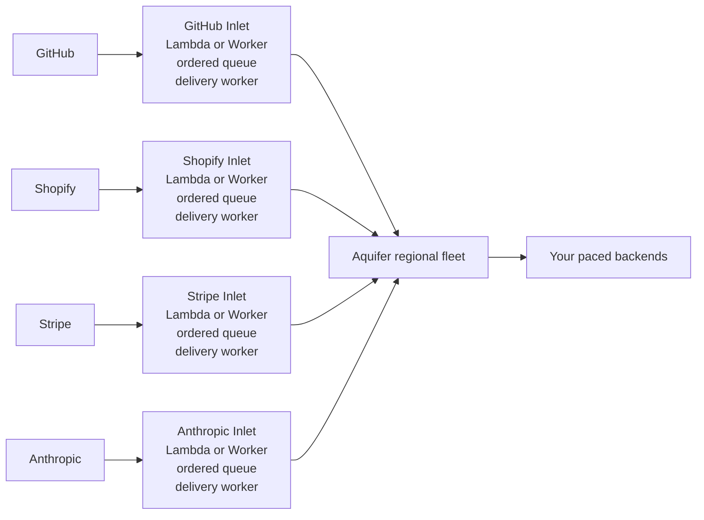

# Inlet

Inlet verifies provider webhooks and places them into an ordered queue before [Aquifer](https://github.com/rjpruitt16/aquifer). Aquifer then applies per-user fairness, durable dispatch, dynamic pacing, and retries without exposing Aquifer directly to the internet.

GitHub, Shopify, Stripe, and Anthropic are supported. Inlet is Apache-2.0 licensed.

## Recommended Topology

Deploy one Inlet stack per provider. Every stack uses the same Inlet code, but keeps that provider's signing secret, ordered backlog, concurrency, and failures isolated. A single multi-route deployment is supported when operational simplicity matters more than isolation.



On AWS, each provider stack contains an HTTP intake Lambda, an SQS FIFO queue, and a delivery Lambda. On Cloudflare, it contains a Worker and per-fairness-key Durable Objects whose alarms deliver to Aquifer.

## Delivery

Queue-first delivery is the default and the only mode in the first release:

1. Verify the provider signature against the exact request body.
2. Extract the provider event ID, event type, and default fairness identity.
3. Durably enqueue the event before acknowledging the provider.
4. Submit it to `POST /jobs` with the fairness identity as `user_id`, the provider event ID in the idempotency key, and `X-Aqueduct-Account-Queue: true`.
5. Keep the queue message after Aquifer returns `201`.
6. Resubmit after about four seconds with jitter. Delete the queue message only after two successful Aquifer acknowledgments for the same job, ending with `200` and `duplicate: true`.
7. Retry timeouts, `408`, `429`, and `5xx` with exponential backoff and full jitter. Honor `Retry-After`. Move permanent failures to the dead-letter queue.

Failures do not count as confirmation. If the first response is lost, `timeout -> 200 duplicate` still needs one more matching `200 duplicate` before Inlet removes the queue message. After an external queue redelivery, AWS conservatively starts a new two-observation cycle, so `201 -> 503 -> 200 duplicate -> 200 duplicate` is a valid recovery sequence.

## Fairness And Ordering

Ordering before Aquifer is per route and `user_id`, never global. Different users and routes can progress concurrently while events in one route for one user remain ordered through Aquifer acceptance. Aquifer then preserves that user's account-queue ordering during dispatch.

| Provider | Default `user_id` source |
|---|---|
| GitHub | installation ID, then organization, repository owner, or sender |
| Shopify | shop domain |
| Stripe | event account, `Stripe-Account`, or Stripe context |
| Anthropic | workspace or organization identity |

When a provider event has no default identity, Inlet uses `route:<route-id>`. Override the default with `fairness_key`:

```yaml
fairness_key: provider                 # provider default
fairness_key: header:x-tenant-id       # request header
fairness_key: body:/account/id         # JSON Pointer
fairness_key: literal:shared-tenant    # fixed identity
```

AWS uses an SQS FIFO message group derived from the route and `user_id`. Cloudflare uses one Durable Object queue per route and `user_id`; the object stores events and advances its head only after Aquifer confirms ownership.

## Configuration

See [`inlet.example.yml`](inlet.example.yml). Routes are deployment configuration, not caller-controlled destinations.

```yaml
aquifer_url: http://aquifer.internal:8080
routes:
  - id: github-main
    path: /webhooks/github/main
    provider: github
    secret_ref: GITHUB_WEBHOOK_SECRET
    destination: https://backend.example.com/webhooks/github
```

`secret_ref` names an environment variable on AWS or a secret binding on Cloudflare. AWS also accepts `env:NAME` and `aws-secrets:secret-id`; Cloudflare accepts `binding:NAME`.

`webhook_url` is not sent to Aquifer unless a route configures `completion_url`. Inlet only needs Aquifer to own the provider event. Aquifer retains the terminal result for polling.

## AWS

An AWS deployment contains two Lambda handlers from the same package:

- `httpHandler` verifies public webhook requests and writes SQS FIFO.
- `queueHandler` consumes groups sequentially and submits to Aquifer.

Required environment variables:

| Variable | Purpose |
|---|---|
| `INLET_CONFIG` | YAML configuration |
| `INLET_QUEUE_URL` | SQS FIFO queue URL |
| `INLET_DLQ_URL` | FIFO dead-letter queue URL for permanent failures |
| `INLET_AQUIFER_TIMEOUT_MS` | Aquifer request timeout, default `5000` |

Configure the SQS event source with partial batch responses and bounded maximum concurrency. When one message must retry, Inlet leaves that message and all later messages from its group unacknowledged while unrelated groups continue.

The recommended container deployment uses the root [`Dockerfile`](Dockerfile) and the provider-isolated [SAM image template](examples/aws/template.image.yaml). See [the AWS deployment guide](examples/aws/README.md) for the two-command build/deploy flow. The original [zip-based SAM template](examples/aws/template.yaml) remains available for multi-route deployments.

## Cloudflare

The Worker `fetch` handler verifies intake. `InletQueueObject` is the Durable Object class that provides the ordered queue and alarm-driven Aquifer delivery. Bind it as `INLET_ORDERING`; optionally bind a Cloudflare Queue named `INLET_DLQ` for permanent failures.

Provider secrets are Worker secret bindings named by each route's `secret_ref`. `INLET_CONFIG` contains the YAML configuration.

See [the Cloudflare deployment guide](examples/cloudflare/README.md) and its provider-specific [`wrangler.jsonc`](examples/cloudflare/wrangler.jsonc) example.

## Aquifer Engineering

The repository includes an [Aquifer Engineer skill](.agents/skills/aquifer-engineer/SKILL.md) for coding agents benchmarking backends, tuning Aqueduct pacing, partitioning Aquifer, configuring Valkey high availability, driving autoscaling, and designing priority tiers.

## Development

```bash
npm install
npm test
```
