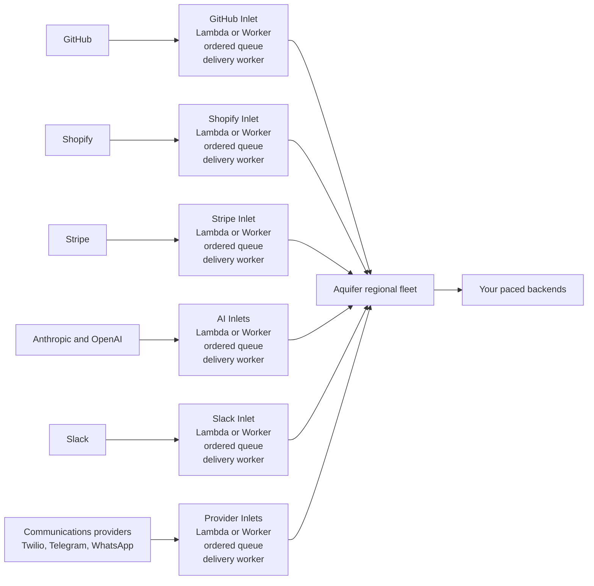

# Inlet

Inlet verifies provider webhooks and places them into an ordered queue before [Aquifer](https://github.com/rjpruitt16/aquifer). Aquifer then applies per-user fairness, durable dispatch, dynamic pacing, and retries without exposing Aquifer directly to the internet.

Inlet is Apache-2.0 licensed.

## Supported Integrations

| Provider | Verification | Default fairness identity, in precedence order |
|---|---|---|
| GitHub | HMAC-SHA256 signature | `installation.id` -> `organization.id` -> `repository.owner.id` -> `sender.id` |
| Shopify | HMAC-SHA256 signature | shop-scoped customer ID -> `X-Shopify-Shop-Domain` |
| Stripe | Timestamped HMAC-SHA256 signature | event `account` -> `Stripe-Account` -> `Stripe-Context` |
| Anthropic | Standard Webhooks signature | `data.id` -> `data.session_id` -> workspace ID -> organization ID |
| OpenAI | Standard Webhooks signature | project ID -> organization ID |
| Slack | Signed `v0` HMAC-SHA256 request | workspace/team ID -> enterprise ID |
| Twilio | HMAC-SHA1 signature over the public URL and request parameters | account SID -> messaging-service SID -> service SID |
| Telegram | Webhook secret-token header | chat ID -> sender ID -> user ID |
| WhatsApp Cloud API | Meta HMAC-SHA256 signature | message sender -> status recipient -> contact ID -> phone-number ID -> WhatsApp Business Account ID |

If none of a provider's keys is present, Inlet uses `route:<route-id>`. Any route can replace these defaults with an explicit `fairness_key`.

## Canalis plugins

Running [Canalis](https://github.com/rjpruitt16/canalis-rs) already? Inlet's providers also build into Canalis webhook plugins (`plugins/canalis`, `npm run build:canalis-plugins`), so Canalis can verify webhooks itself with no Lambda. They're built from the same provider code, so both verify webhooks identically. Shopify is available today.

## Recommended Topology

Deploy one Inlet stack per provider. Every stack uses the same Inlet code, but keeps that provider's signing secret, ordered backlog, concurrency, and failures isolated. A single multi-route deployment is supported when operational simplicity matters more than isolation.



On AWS, each provider stack contains an HTTP intake Lambda, an SQS FIFO queue, and a delivery Lambda. On Cloudflare, it contains a Worker and per-fairness-key Durable Objects whose alarms deliver to Aquifer.

## Deploy With The CLI

Two commands set up a complete deployment from one `inlet.yml`:

```bash
npx @aqueduct/inlet init      # answer a few questions; writes inlet.yml
npx @aqueduct/inlet deploy    # creates or updates everything, prints your webhook URL
```

`init` asks where Inlet runs (AWS or Cloudflare), the delivery mode on AWS (SQS, or your own Kafka), the provider, your backend URL and Aquifer's URL. Every question also has a flag, such as `--platform aws --delivery kafka --provider github`, for scripts. `npx @aqueduct/inlet help` lists them.

`deploy` reads `inlet.yml` and creates what that setup needs:

| Setup | What deploy creates |
|---|---|
| AWS + SQS | Intake and delivery Lambdas, an HTTP API, FIFO queue and dead-letter queue, IAM role, log groups |
| AWS + Kafka | Intake, delivery and reconciler Lambdas, an HTTP API, a Kafka trigger per events topic, the 5-minute reconcile schedule, the completion signing secret, and any missing topics |
| Cloudflare | The Worker with its ordered-queue Durable Object, and the dead-letter queue |

- On AWS it bundles the code itself, so it needs only the AWS CLI with working credentials: no Docker, SAM or S3 bucket.
- On Cloudflare it uses Wrangler and your `wrangler login`.
- Secrets that don't exist yet (provider signing secrets, Kafka credentials) are asked for once and stored in Secrets Manager or as Worker secrets. Without a terminal, it reads them from `INLET_SECRET_<NAME>` (and `INLET_KAFKA_USERNAME`).
- Running `deploy` again updates the deployment in place.
- It never creates a Kafka cluster: you bring the brokers, reachable over TLS.

`npx @aqueduct/inlet destroy` deletes the deployment. Secrets and Kafka topics are kept unless you pass `--delete-secrets`; topics are always kept, since they hold your event history.

Everything in `inlet.yml` except the `deploy:` block is the runtime configuration below:

```yaml
deploy:
  platform: aws              # aws | cloudflare
  name: inlet-github         # stack or Worker name
  region: us-east-2          # aws only
  kafka:                     # delivery: kafka only
    brokers: broker-1.example.com:9093
    sasl_mechanism: scram-sha-512
    credentials_secret: inlet-github-kafka
    partitions: 6
```

The SAM templates in [`examples/aws`](examples/aws) and the Wrangler config in [`examples/cloudflare`](examples/cloudflare) remain for teams that manage their own infrastructure as code.

## Delivery

Event delivery is queue-first. Provider setup challenges are verified and answered immediately without entering the queue:

1. Verify the provider signature against the exact request body.
2. Extract the provider event ID, event type, and default fairness identity.
3. Durably enqueue the event before acknowledging the provider.
4. Submit it to `POST /jobs` with the fairness identity as `user_id`, the provider event ID in the idempotency key, and `X-Aqueduct-Account-Queue: enabled`.
5. Keep the queue message after Aquifer returns `201`.
6. Resubmit after about four seconds with jitter. Delete the queue message only after two successful Aquifer acknowledgments for the same job, ending with `200` and `duplicate: true`.
7. Retry timeouts, `408`, `429`, and `5xx` with exponential backoff and full jitter. Honor `Retry-After`. Move permanent failures to the dead-letter queue.

Failures do not count as confirmation. If the first response is lost, `timeout -> 200 duplicate` still needs one more matching `200 duplicate` before Inlet removes the queue message. After an external queue redelivery, AWS conservatively starts a new two-observation cycle, so `201 -> 503 -> 200 duplicate -> 200 duplicate` is a valid recovery sequence.

## Fairness And Ordering

Ordering before Aquifer is per route and `user_id`, never global. Different users and routes can progress concurrently while events in one route for one user remain ordered through Aquifer acceptance. Aquifer then preserves that user's account-queue ordering during dispatch.

Override the provider defaults above with `fairness_key`:

```yaml
fairness_key: provider                 # provider default
fairness_key: header:x-tenant-id       # request header
fairness_key: body:/account/id         # JSON Pointer
fairness_key: literal:shared-tenant    # fixed identity
```

AWS uses an SQS FIFO message group derived from the route and `user_id`. Cloudflare uses one Durable Object queue per route and `user_id`; the object stores events and advances its head only after Aquifer confirms ownership.

## Configuration

See [`inlet.example.yml`](inlet.example.yml). Routes are deployment configuration, not caller-controlled destinations.

```yaml
aquifer_url: http://aquifer.internal:8080
routes:
  - id: github-main
    path: /webhooks/github/main
    provider: github
    secret_ref: GITHUB_WEBHOOK_SECRET
    destination: https://backend.example.com/webhooks/github
```

`secret_ref` names an environment variable on AWS or a secret binding on Cloudflare. AWS also accepts `env:NAME` and `aws-secrets:secret-id`; Cloudflare accepts `binding:NAME`.

Telegram's `secret_ref` must match the `secret_token` passed to `setWebhook`. WhatsApp uses the Meta app secret in `secret_ref` and requires a separate `verification_secret_ref` for the GET subscription challenge.

Twilio signs the exact public webhook URL. Inlet derives it from the incoming request; set `public_url` when a proxy changes the scheme, host, or path. Twilio support is intended for status callbacks and events that only require a `2xx` acknowledgment. Do not queue a Twilio webhook that must return TwiML synchronously.

OpenAI uses its webhook endpoint signing secret in `secret_ref`. Slack uses the app signing secret, verifies and answers the Events API URL challenge before queueing, and supports JSON events plus form-encoded slash commands and interactions. Slack commands that need a later user-visible response should use Slack's `response_url`; Inlet only provides the immediate acknowledgment.

`webhook_url` is not sent to Aquifer unless a route configures `completion_url`. Inlet only needs Aquifer to own the provider event. Aquifer retains the terminal result for polling.

## AWS

An AWS deployment contains two Lambda handlers from the same package:

- `httpHandler` verifies public webhook requests and writes SQS FIFO.
- `queueHandler` consumes groups sequentially and submits to Aquifer.

Required environment variables:

| Variable | Purpose |
|---|---|
| `INLET_CONFIG` | YAML configuration |
| `INLET_QUEUE_URL` | SQS FIFO queue URL |
| `INLET_DLQ_URL` | FIFO dead-letter queue URL for permanent failures |
| `INLET_AQUIFER_TIMEOUT_MS` | Aquifer request timeout, default `5000` |

Configure the SQS event source with partial batch responses and bounded maximum concurrency. When one message must retry, Inlet leaves that message and all later messages from its group unacknowledged while unrelated groups continue.

The recommended container deployment uses the root [`Dockerfile`](Dockerfile) and the provider-isolated [SAM image template](examples/aws/template.image.yaml). See [the AWS deployment guide](examples/aws/README.md) for the two-command build/deploy flow. The original [zip-based SAM template](examples/aws/template.yaml) remains available for multi-route deployments.

## Cloudflare

The Worker `fetch` handler verifies intake. `InletQueueObject` is the Durable Object class that provides the ordered queue and alarm-driven Aquifer delivery. Bind it as `INLET_ORDERING`; optionally bind a Cloudflare Queue named `INLET_DLQ` for permanent failures.

Provider secrets are Worker secret bindings named by each route's `secret_ref`. `INLET_CONFIG` contains the YAML configuration.

See [the Cloudflare deployment guide](examples/cloudflare/README.md) and its provider-specific [`wrangler.jsonc`](examples/cloudflare/wrangler.jsonc) example.

## Kafka Delivery

Set `delivery: kafka` to use your own Kafka instead of SQS FIFO: Confluent, Redpanda, MSK or self-hosted. Each deployment uses one mode. SQS stays the default and works exactly as before, with no reconciliation.

Kafka mode adds a durable history of every webhook and every outcome, and a reconciler that redrives events that never finished, for example because an Aquifer machine disappeared with accepted jobs.

```yaml
aquifer_url: https://aquifer.internal.example
delivery: kafka
kafka:
  events_topic: inlet.events       # default
  results_topic: inlet.results     # default
  reconcile:
    after_seconds: 1800            # default: an event with no result after 30 minutes is overdue
    search_window_seconds: 3600    # default: how far past an event to look for its result
    max_redrives: 3                # default
routes:
  - id: github-main
    path: /webhooks/github/main
    provider: github
    secret_ref: aws-secrets:github-webhook-secret
    destination: https://backend.example.com/webhooks/github
    events_topic: github.events    # optional, per route
    results_topic: github.results  # optional, per route
```

How it works:

1. The intake verifies the webhook and writes an `inlet.event.v1` record to the route's events topic before answering the provider. The Kafka key is the route and fairness identity, so one user's events share a partition and stay in order.
2. Lambda's Kafka trigger delivers batches to the dispatcher. It submits each user's events to Aquifer in order, then confirms the whole batch with one wait, using the same two-observation check as SQS. It writes `owned` when Aquifer confirms it holds the job.
3. Aquifer's completion webhook comes back to Inlet at a signed `/_inlet/completions` URL, and Inlet writes `completed` or `failed`. Aquifer and Spillway need no Kafka support.
4. Every 5 minutes the reconciler reads the events topic from its own cursor (a consumer group's committed offsets) and stops at the first event that isn't overdue yet. For each overdue event it looks for a result in the results topic within `search_window_seconds`:
   - `completed` or `dead_letter`: done.
   - `failed`: redriven with a new Aquifer idempotency key, so Aquifer runs it again.
   - No terminal result: redriven with the same key. If Aquifer still has the job it answers duplicate; if the job was lost it creates it again.
   - After `max_redrives`, it writes `gave_up`.

   A redrive is written to the events topic before it's recorded as `redriven`, and the cursor moves only after both, so a crash leaves at most a duplicate, which Aquifer deduplicates.

### Records

Events (`inlet.event.v1`): `delivery_id` (stable across redrives), `partition_key`, `event_id`, `event_type`, `provider`, `route_id`, `user_id`, `destination`, `method`, `content_type`, `headers`, `body_base64`, `received_at`, `written_at`, `reconcile_after`, `redrive`, `key_generation`, `idempotency_key`, `events_topic`, `results_topic`, and when present `max_retries`, `execute_before`, `traceparent`.

Results (`inlet.result.v1`), keyed by `delivery_id`: `status` is one of `owned`, `completed`, `failed`, `dead_letter`, `redriven`, `gave_up`, plus `job_id`, `response_status`, `reason`, `redrive`, `key_generation`, `source` (`dispatch`, `completion` or `reconciler`) and `recorded_at`. The destination's response body isn't stored.

### What "completed" means

- `owned`: Aquifer confirmed it holds the job.
- `completed`: the destination answered Aquifer with 2xx.
- Whether your backend finished its own asynchronous work afterwards is outside what Inlet can see.

Delivery is at least once. Every request carries `x-inlet-event-id` and `x-inlet-delivery-id`, so your backend can drop repeats. Exactly-once side effects need your backend to deduplicate on them.

### Settings

| Variable | Purpose |
|---|---|
| `INLET_KAFKA_BROKERS` | Comma-separated bootstrap servers |
| `INLET_KAFKA_SASL_MECHANISM` | `scram-sha-512`, `scram-sha-256` or `plain`; unset for no SASL |
| `INLET_KAFKA_SECRET_REF` | Secret with `{"username","password"}`, the same format Lambda's Kafka trigger reads |
| `INLET_KAFKA_SSL` | `false` to turn TLS off (default on) |
| `INLET_COMPLETION_SECRET_REF` | Key that signs completion URLs |
| `INLET_PUBLIC_URL` | Inlet's public base URL, for completion URLs (dispatcher only) |
| `INLET_KAFKA_RECONCILER_GROUP` | Consumer group that holds the reconciler's cursor (default `inlet-reconciler`) |

[`examples/aws/template.kafka.yaml`](examples/aws/template.kafka.yaml) deploys the intake, dispatcher (`kafkaHandler`) and reconciler (`reconcileHandler`) against your Kafka. Create the topics first. The template's functions run outside a VPC, so the brokers must be reachable from the internet over TLS; its comments show what to add for brokers inside a VPC. It uses SASL/SCRAM-SHA-512; for SASL/PLAIN (Confluent Cloud) change the two lines its comments point to.

Limits:

- A Kafka partition holds many users. While one user's event is retried, other users' events in the same partition wait behind it. More partitions make that rarer.
- Records are limited by your topic's maximum message size (1 MB by default).
- `completion_url` can't be combined with Kafka mode, because Inlet receives completions itself.
- Kafka mode runs on AWS today. Cloudflare support is planned.

## Aquifer Engineering

The repository includes an [Aquifer Engineer skill](.agents/skills/aquifer-engineer/SKILL.md) for coding agents benchmarking backends, tuning Aqueduct pacing, partitioning Aquifer, configuring Valkey high availability, driving autoscaling, and designing priority tiers.

## Development

```bash
npm install
npm test
```
